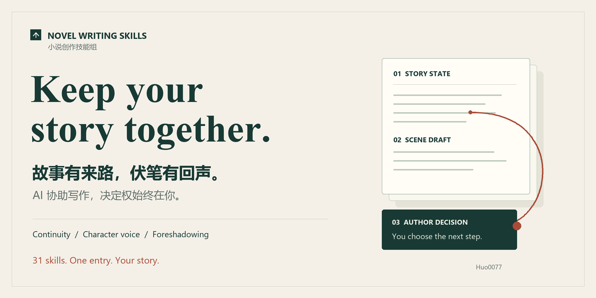

# 小说创作 Skills

**简体中文** | [English](README.en.md) · [许可证：MIT](LICENSE)



**让 AI 协助你写长篇，同时把故事的决定权留在你手里。**

这是一套面向小说创作者的 AI 协作技能组。它把设定整理、剧情规划、正文写作、文段回审和修订衔接起来，帮助你处理写长篇时常见的上下文遗忘、角色漂移、重复表达、节奏失控和过于明显的伏笔。

你不需要记住 31 个技能名。通过一个入口 `novel-router`，用自然语言说明当前任务即可。

[🎬 70秒官方演示视频](docs/demo.html) · [安装与下载 v1.2](https://github.com/Huo0077/novel-writing-skills/releases/tag/v1.2) · [完整使用指南](docs/novel-skills/skills组使用指南.md) · [快速开始](小说skills-快速开始.md) · [历史版本](https://github.com/Huo0077/novel-writing-skills/releases)

> 这不是独立运行的小说生成软件，而是一套供**能读取、编辑本地文件，并遵循技能指令的 AI 助手**使用的流程与工具。普通聊天窗口不会因为下载了文件就自动具备这些能力。

## 🎬 70 秒官方演示视频

[](docs/demo.html)

> 📺 **在线全屏交互放映**：点击上方动图或直接访问 [`docs/demo.html`](docs/demo.html)（内置中英双语切换、拟真人声配音解说、音效合成与 WebM 视频导出）  
> 📥 **高清视频直链**：[`docs/assets/novel-skills-demo.mp4`](docs/assets/novel-skills-demo.mp4) (1080P)

## 为什么需要这套技能组？

一次生成流畅的文段，不等于能持续写好一部小说。长篇协作中，难点往往不是“缺一句更漂亮的描述”，而是前文、人物、线索与修改后果没有被持续维护。

这套技能组把下面的问题拆成可检查、可讨论、可追踪的任务：

| 写作痛点 | 典型表现 | 对应处理机制 |
|---|---|---|
| **上下文遗忘与状态矛盾** | 受伤角色突然奔跑、物品去向改变、承诺被遗忘、世界规则被临时突破 | 外置世界、人物、事件与时间线档案；写前装配相关状态，写后提取实际变化 |
| **表达同质化** | 同一动作、句式、比喻或标点反复出现，用近义词替换后仍然模板化 | 统计重复位置，再按语境区分有效与无效重复；保护意象，提供句群或叙述角度候选 |
| **角色趋同与偏离** | 所有人说话方式相似，角色为了推进剧情突然降智、变性格或恢复信任 | 核对目标、底线、关系和知情来源；用注意焦点、对白策略及压力变体区分声音 |
| **节奏与信息释放失控** | 一章塞入过多设定，过早解释主谋，情绪未积累就爆发，高潮之后没有余波 | 限定章节/场景功能与退出条件；区分冲突呈现与真相解释，审查信息负荷和情绪后果 |
| **伏笔明显，回收缺乏惊喜** | “意味深长”反复提醒读者；线索只有一个解释；反转靠临时新增事实 | 先赋予线索当前用途，再设计有证据的竞争解释；控制分布、揭示门槛与回看意义 |
| **人物选择与情节因果断裂** | 偶然拿到关键证据便解决一切，人物选择没有理由，胜负不产生后果 | 审查目标—阻力—选择—代价—结果—延迟后果；区分缺口与尚未到来的回收 |
| **修订牵一发动全身** | 改了前文，却没同步后文知识、时间、关系或伏笔；越改越乱 | 区分纯措辞与事实变更，追踪已读依赖与未读盲点，保留旧稿并列同步范围 |
| **缺资料时 AI 擅自补设定** | 一个“合理猜测”变成正史，推荐方案被视作作者已经同意 | 一次询问一个关键缺口，给 2–3 个方向及影响；允许自定义或暂缓，答复只确认明确范围 |
| **续写难恢复，过程不透明** | 换任务后不知停在哪里、哪些还待决定，计划目标被误当实际完成 | 检查点分开保存确定、暂定与待确认内容；记录来源、未实现目标和下一步安全动作 |

这些机制用于**降低风险、让问题可追踪**，不保证 AI 永不遗忘，也不保证每个反转都会令人惊艳。

## 功能优势：把单次提示变成可维护的协作流程

### 1. 一个入口，按需调用

`novel-router` 根据当前任务选择 31 个模块中的必要部分。创作者说“续写这一场”或“检查这条伏笔”，不必自己编排整套链，也不用每次加载全部规则。

### 2. 故事状态不只留在聊天里

通过 `.novel/` 保存世界限制、人物状态、时间线、事件、线索和知情边界。资料有来源、状态和生效时点；“已确认未来要发生”不等于“角色已经经历”。

### 3. 规划、生成、审查与决定分工

```text
规划当前单位 → 装配有限上下文 → 生成草稿
→ 回审实际变化 → 分级确认 → 更新档案与检查点
```

计划希望实现什么，与正文实际完成什么分开记录；流畅的草稿不会自动成为正史。调用与交接是助手执行流程，不是后台自动程序。

### 4. 创作者掌握方向，AI 补充选项

支持作者助手、协同作者、半自动长篇三种模式。资料不足先询问，不默认选推荐项；重大改动先说明影响，小范围答复不扩大成整部故事的授权。

### 5. 多样化不牺牲作品辨识度

保留有意的主题意象、口头禅和回环。优先调整冗余解释、信息顺序或句群，而不是把每个高频词都换成生僻近义词；新增动作、承诺与线索照样回审。

### 6. 伏笔兼顾自然性、公平性和后果

不只追求“读者猜不到”。线索先参与当下场景，真相要有前置依据，回收应改变过去理解和人物行动。独立阅读材料与作者答案分离，未执行测试不会伪造读者反馈。

### 7. 本地可追溯，迁移不覆盖

正文、候选、来源和进度以可阅读的文件保存，便于你与助手核查。空白种子、共享协议和模板可随整组迁移；初始化先预览，只新增缺失文件，保留已有资料。

### 8. 工具计算与文学判断分开

表达统计、材料字段检查、状态验证和整组验收有实际工具；因果、角色、节奏和伏笔质量仍需要语境判断与作者反馈。可运行检查降低操作错误，不替代创作审美。

## 适合谁？

- 已有设定或原稿，希望让 AI 帮忙整理、续写和回审的创作者。
- 正在写长篇或连载，需要持续维护人物、支线、伏笔和进度的人。
- 希望 AI 主动提供方案，但不愿把剧情决定权全部交给模型的人。

如果你期待完全无人监督、输入一句话就自动完成高质量长篇，这套工具并不承诺这种结果。

## 开始使用：三步

### 1. 用 npx 安装完整技能组（推荐）

先准备 Node.js 与 npm/npx。在你的小说项目目录打开终端，运行：

```bash
npx skills add Huo0077/novel-writing-skills
```

按安装器提示选择 **全部 31 个技能** 和目标助手。仅安装 `novel-router` 会缺少实际执行模块；安装器不会替你初始化作品、创作内容或自动装 Python。

已用 `skills@1.7.2` 实测的 Codex 项目级安装命令：

```bash
npx skills@1.7.2 add Huo0077/novel-writing-skills --agent codex --skill '*' --copy
```

本次实测安装器要求 **Node.js ≥ 22.20.0**，后续版本请以其提示为准。`--copy` 复制技能，避免依赖符号链接权限；重新安装/更新可能替换同名技能目录，先备份你手改过的技能。这个保护不等同于下一步作品资料的“只增不覆盖”。

Codex 的本次项目安装位置为 `.agents/skills/`；其他助手选择对应 agent，按安装器实际输出定位。仓库源码中的 `.codex/skills/` 是开发布局，不应拿它当所有客户端的安装位置。

### 2. 初始化作品档案，再让助手开始

在同一作品目录预览初始化，不需要 Python 或额外 Node 依赖：

```bash
node .agents/skills/novel-router/scripts/init-project.mjs --target .
```

确认预览范围后，补齐缺失的 `.novel/` 文件：

```bash
node .agents/skills/novel-router/scripts/init-project.mjs --target . --apply
node .agents/skills/novel-router/scripts/init-project.mjs --check
```

初始化只增加空白资料，不覆盖原稿、不重装技能、不复制 QA 故事；已有同路径文件保留，但旧格式仍需检查。`--check` 只核安装资源和技能是否齐全，不是小说事实、YAML内容或文学质量校验。

然后告诉助手：

```text
请读取本项目已安装的 novel-router/SKILL.md，并按它处理我的小说任务。

我想开始一部新小说。先了解我的创作目标和已有想法，一次只问一个关键问题。
缺少信息时，给我 2–3 个不同方向及其影响，也允许我自己补充或暂时不决定。
不要把你推荐的方案直接当成我的设定。
```

如果助手找不到技能，提供实际 `novel-router/SKILL.md` 的完整路径。**安装文件成功不等于所有客户端都自动加载了技能**；必要时重新打开会话并明确要求阅读入口。

已有原稿可保留在原处，先提供当前章节和必要设定，不用一次填完整百科。全局安装、ZIP备用与迁移见下方。

### 3. 选择你希望的协作方式

| 模式 | 适合你希望…… | AI 的工作方式 |
|---|---|---|
| **作者助手** | 自己决定剧情，只让 AI 整理、扩写和检查 | 以执行你的意图和提出建议为主 |
| **协同作者** | 与 AI 一起讨论人物选择、剧情和伏笔 | 可以主动提供候选方向，并说明后果 |
| **半自动长篇** | 沿已确认方向分批推进，减少反复操作 | 在批准范围内规划和写作，遇重大变更暂停 |

模式可以按项目或任务切换。**半自动不等于无监督**：改变世界规则、核心动机、关键事件结果或完整揭示等高风险操作仍需要你确认。

## 直接这样提出任务

使用时先让助手读取总控入口，之后说明任务即可，不必自己编排技能链。

### 续写当前场景

```text
继续这一场。先核对人物伤势、物品、关系和知识边界，列出当前目标与不能揭示的内容。
如果关键资料缺失，先问我；确认范围后再写。
达到本场退出条件就停，回审实际发生的变化，不自动推进到下一章。
```

### 检查前后矛盾

```text
检查这段正文与已有设定是否矛盾。
把明确矛盾、可能问题和资料不足分开，给出正文与档案来源。
先提供修复方向，不改我的正史。
```

### 减少重复表达

```text
检查这章高频词组、句式、动作和标点。
先区分有效、可疑、无效重复，保留主题意象和角色声音。
对需要改的地方给语境化候选，说明是否新增动作或改变原意，不机械替换同义词。
```

### 改进过于明显的伏笔

```text
这条伏笔太容易看出来。检查它是否有当前场景中的自然用途、是否被旁白过度强调。
给出有证据支持的竞争解释，并检查揭示后能否重新解释旧内容。
如果真相或场景用途还没确定，先向我提问，不自行造新秘密。
```

### 结束本次写作

```text
保存当前进度：哪些事实已确认、哪些暂定、哪些等我决定。
记录未兑现的承诺、待推进伏笔、下一步安全任务和不能提前揭示的内容。
```

## 你始终拥有决定权

**缺信息时先问，不默认替你选。** 助手先查看已有资料，再询问当前阻塞点；选项会说明差异与影响，你可以选择、自定义或暂缓。只回答一部分，就只确认那一部分。

**草稿不是自动正史。** 系统区分已确认事实、暂定内容、候选提案和草稿。计划“这一章要拿到账本”，不意味着正文已经实际完成；写后会回审结果。

**按影响分级确认。**

- 低风险：可记录为暂定状态。
- 中风险：在任务或阶段结束时汇总确认。
- 高风险：先暂停，说明影响并询问。

**修订保留原稿。** 改写另存版本；如果新增动作、承诺、线索或知情状态，就作为事实变化检查，而不是假装只是语言润色。

## 写作资料放在哪里？

```text
.agents/skills/  标准安装示例；实际位置取决于目标助手，novel-router 是统一入口
.novel/
  canon/        世界、人物、时间线、关键事件、伏笔与信息边界
  planning/     总纲、章节与场景计划
  drafts/       正文草稿与历史版本
  reviews/      回审、表达、连续性与节奏检查
  proposals/    等待决定的建议、状态变更与澄清问题
  checkpoints/  可恢复的写作进度
  schemas/      共用协议
  templates/    记录模板
```

`canon/` 是档案位置，不代表里面每条候选都已确认。状态与来源仍要明确记录。

测试目录中的人物和故事只用于验收，**不是你的作品设定**。公开下载包是空白项目种子，不携带创作者真实作品数据。

> **保护你的原稿与秘密：** 本仓库是公开的。不要将填写了真实作品内容的 `.novel/`、正文、作者真相或私人提案直接提交到公开仓库。使用本地目录或你自己的私有工作区，并自行做好备份。

## 全局安装、ZIP备用与可选工具

### 全局安装

需要跨作品使用时，可安装到用户级技能目录：

```bash
npx skills@1.7.2 add Huo0077/novel-writing-skills --global --agent codex --skill '*' --copy
```

全局安装后**不会自动生成任何作品档案**。请让助手定位全局 `novel-router/scripts/init-project.mjs`，以脚本绝对路径和 `--target 你的作品目录` 运行预览，确认后加 `--apply`。不要在全局技能文件夹里写小说。卸载技能和删除作品是两件事；本次隔离卸载演练确认 `.novel/` 仍保留。

### ZIP备用安装

从 [v1.2 Release](https://github.com/Huo0077/novel-writing-skills/releases/tag/v1.2) 下载 `novel-writing-skills-v1.2.zip`，解压到空的新目录并让助手打开。ZIP保留 `.codex/skills/` 的仓库布局，可用：

```bash
node .codex/skills/novel-router/scripts/init-project.mjs --target . --apply
```

不要直接解压覆盖旧作品；保留 `.codex/`、`.novel/` 隐藏目录。单个 `SKILL.md` 不足以携带共享资料。

### 开发与完整验收

安装/作品初始化只需要 Node。表达统计、读者材料工具和完整 Python 回归仍是**可选 Python/PyYAML 依赖**；Python 未安装时不会自动替你安装。完整QA在仓库/ZIP的源布局运行，不假定技能安装器会为作品复制QA：

```powershell
python -m pip install "PyYAML>=6.0,<7.0"
python .codex/skills/novel-router/scripts/suite.py validate --tests
```

仓库也提供 `npm test`，只运行 Node 初始化测试，不伪装为已执行全部 Python 或文学评估。没有独立的同名 npm 注册包、npm publish或隐式postinstall；`skills` 是复用的安装器。

目前技能正文与大部分参考资料以中文为主。英文 README 不代表全部技能或工具已本地化；表达统计的默认词组、句式与汉字片段分析也面向中文正文。

## 已验证什么，还没验证什么？

v1.2 保留 v1.1 的六类校验修复与全组澄清协议，并增加标准技能安装、路径兼容和 Node 初始化。v1.2完整验收结果及实际安装环境见[安装验收报告](docs/installation-v1.2.md)；v1.1历史复核为122案例、121通过、1权限项跳过。

这些检查验证格式、工具和资料交接，**不是**独立模型对话、真人首次阅读或长篇文学质量实验。仍需关注：

- 长篇中是否持续正确读取和更新状态，要靠实际作品检验。
- 重复表达统计不等于中文分词或“AI 作者鉴定”。
- 知道真相的会话不能充当独立读者；首次阅读测试需要没见过答案的新上下文或真人。
- 公开信息包与作者笔记分离是流程约束，不是技术访问隔离。
- 未承诺全局安装、界面自动发现或后台自动多代理写作。

完整证据见[复核报告](docs/novel-skills/GitHub-v1.1-复核报告.md)和[验证摘要](docs/novel-skills/verification/v1.1-public-verification.json)。历史 v1.0 保留在 Releases 中，存在已知校验缺陷，建议使用 v1.2。

## 许可证

本项目采用 [MIT 许可证](LICENSE)。你可以在遵守许可条件的前提下使用、修改、分发或商用项目文件；分发本项目或其实质性部分时，请保留版权及许可声明。项目按许可证约定不提供担保。

该许可适用于本项目作者提供的代码、技能说明、协议、模板及其他项目文件，**不要求你把自己的小说、原稿、设定或写作成果按 MIT 公开**，也不意味着项目作者取得这些作品的权利。第三方材料仍须遵守其适用授权；AI 生成内容的权利归属不由本许可证单独保证。

v1.2 ZIP包含LICENSE，每个可独立安装的skill也携带LICENSE.txt。历史v1.0、v1.1 ZIP保持原样，使用旧包时请同时查阅并保留本仓库的 [LICENSE](LICENSE)。

## 更多说明

- [English README](README.en.md)
- [完整使用指南与 31 个模块职责](docs/novel-skills/skills组使用指南.md)
- [快速开始](小说skills-快速开始.md)
- [版本发布记录](RELEASES.md)
- [下载与历史版本](https://github.com/Huo0077/novel-writing-skills/releases)

实际使用遇到问题时，反馈当前任务、最小可复现片段、预期行为和实际结果。涉及未公开作品，请先匿名化，避免把真实秘密或完整原稿贴到公开讨论中。
